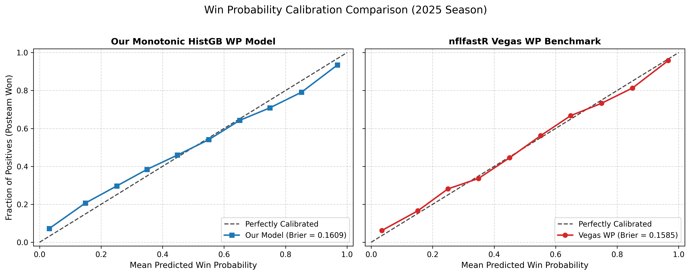

# AQX — NFL 4th-Down Decision Tool & Empirical Audit

[](https://AnuragVerma777.github.io/Fourth--Down-Compass/)
[](https://www.python.org/)
[-success)](tests/test_model_parity.py)
[](LICENSE)

An end-to-end, mathematically rigorous, real-time NFL 4th-down decision engine and empirical coaching audit. The project trains monotonically constrained machine learning models on 2020–2024 NFL play-by-play data, audits all 3,997 fourth-down decisions in the held-out 2025 season with game-clustered bootstrap intervals, and delivers a self-contained, zero-dependency interactive tool for GitHub Pages.

## Project Video

Watch the AQX project walkthrough:

[](https://www.youtube.com/watch?v=uAy3i-Tckko)

---

## 1. The Problem a Coach Faces

Every Sunday, an NFL head coach faces a critical dilemma with fewer than 40 seconds on the play clock: **4th down**.

```
                           THE 4TH-DOWN DILEMMA
                           
                ┌─────────────────────────────────────┐
                │ 4th & 2 at OPP 38 | Down 3 | Q3 4:15│
                └──────────────────┬──────────────────┘
                                   │
         ┌─────────────────────────┼─────────────────────────┐
         ▼                         ▼                         ▼
   [GO FOR IT]               [FIELD GOAL]                 [PUNT]
 58% conversion odds       55-yard attempt (62%)     Pin them deep (~18 yd line)
   High reward:              Conservative:             Illusion of safety:
 Drive alive / TD equity    3 points on board        Surrender ball & momentum
  Risk: Turnover at spot    Risk: Miss = short field   Give up possession equity
```

Coaches face immense psychological and institutional pressures:
1. **The Illusion of Defensive Safety**: Punting is culturally branded as "playing it safe." In reality, giving the opponent the football in midfield or opponent territory destroys win probability far more than failed conversion attempts.
2. **Asymmetric Blame**: A failed 4th-down conversion is visible and criticized on post-game television; a cowardly punt that slowly bleeds 8% win probability goes unmentioned. As analytics pioneers note: *"Punting rarely gets a coach fired, but it often gets them beat."*
3. **Cognitive Overload Under Fire**: Coaches must synthesize yards to go, field position, game clock, score differential, timeouts, and opponent tendencies in seconds without objective quantification of the expected payoffs.

---

## 2. What the Tool Does

The **AQX 4th-Down Decision Tool** replaces gut intuition with expected win probability maximization.

```
                           AQX DECISION ENGINE
                           
                       Current State (X)
                               │
            ┌──────────────────┼──────────────────┐
            ▼                  ▼                  ▼
      [CONV MODEL]        [FG MODEL]         [PUNT MODEL]
      HistGradient       HistGradient       HistGradient
       Classifier         Classifier          Regressor
      P(convert)           P(make)         Opp Starting Spot
            │                  │                  │
            └──────────────┐   │   ┌──────────────┘
                           ▼   ▼   ▼
                     [WIN PROBABILITY MODEL]
                HistGradientBoostingClassifier
               (11 Features + Monotonic Constraints)
                           │
         ┌─────────────────┼─────────────────┐
         ▼                 ▼                 ▼
       Go WP             FG WP            Punt WP
       72.3%             69.1%             65.4%
         │                 │                 │
         └─────────────────┼─────────────────┘
                           │
                           ▼
                  [DECISION SYNTHESIS]
              ★ Recommendation: GO FOR IT
              ★ Margin: +3.2 pp Win Probability
              ★ Break-Even Conversion Rate: 41%
```

### Core Engine Features
* **Three-Branch Probabilistic Evaluation**:
  * **Go for It**: $\mathbb{E}[\text{WP}(\text{Go})] = P(\text{conv}) \cdot \text{WP}(\text{success}) + (1 - P(\text{conv})) \cdot \text{WP}(\text{fail})$. Correctly models touchdowns when goal-to-go.
  * **Field Goal**: $\mathbb{E}[\text{WP}(\text{FG})] = P(\text{make}) \cdot \text{WP}(\text{make}) + (1 - P(\text{make})) \cdot \text{WP}(\text{miss})$. Accurately places the ball at the spot of the kick or the 20-yard line upon a miss.
  * **Punt**: $\mathbb{E}[\text{WP}(\text{Punt})] = 1 - \text{WP}_{\text{opp}}(\text{expected net field position})$. Captures touchback probabilities and return distributions.
* **Break-Even Rate Calculation**: Solves for the exact threshold conversion probability $P^*$ where going for it yields equivalent expected win probability to the best alternative.
* **Dynamic Conversion Odds Override Slider**: Allows coaches to test their own subjective confidence (e.g. *"What if our offensive line is banged up and our odds are 10% lower?"*) with instant recalculation.
* **2D Go-For-It Map**: Visualizes the decision surface across field position and distance with real-time scenario tracking.
* **100% Client-Side Architecture**: Built into a single static `index.html` with zero backend, zero API keys, and verified floating-point parity against Python.

---

## 3. Key Findings with Intervals (2025 Held-Out Season)

We scored every 4th-down decision in the unseen **2025 NFL season** (3,997 plays across 285 games; 570 team-game exposures). All uncertainty intervals are **95% cluster bootstrap confidence intervals** generated by resampling 2,000 whole games (`game_id`) with replacement.

### Executive Metrics

| Metric | Point Estimate | 95% Cluster Bootstrap CI | Interpretation |
| :--- | :---: | :---: | :--- |
| **Go Rate on Clear-Go Calls** *(Margin $\ge$ 1.0 pp)* | **33.1%** | **[30.2%, 36.2%]** | Coaches kick or punt **66.9%** of clear-go situations (396/1,198 plays). |
| **WP Lost per Team per Game** | **37.07 pp** | **[34.20 pp, 39.86 pp]** | The average team leaves over a third of a win on the table each game. |
| **Overall Coach Decision Agreement** | **32.3%** | **[30.6%, 33.9%]** | In less than 1 in 3 decisions did coaches choose the optimal action. |
| **Total Win Probability Sacrificed** | **211.3 wins** | **[194.9, 227.2]** | Over 211 full games of win probability forfeited league-wide in 2025. |

### Sensitivity Test: What If Real Conversion Odds Are 5 Points Lower?
To test whether coach conservatism could be justified by model optimism, we subtracted an aggressive uniform **5.0 percentage points** from every conversion prediction ($\hat{P}_{\text{conv}} - 0.05$):

| Scenario | Clear-Go Opportunities | Coach Go Rate on Clear Go | 95% Bootstrap CI | WP Lost / Team-Game | 95% Bootstrap CI |
| :--- | :---: | :---: | :---: | :---: | :---: |
| **Baseline Model** | 1,198 | **33.1%** | [30.2%, 36.2%] | **37.07 pp** | [34.20 pp, 39.86 pp] |
| **Sensitivity (-5 pp Haircut)** | 1,084 | **34.9%** | [31.9%, 38.0%] | **34.09 pp** | [31.50 pp, 36.61 pp] |
| *Net Difference* | *-114 plays (-9.5%)* | *+1.8 pp* | — | *-2.98 pp (-8.0%)* | — |

> **Conclusion**: Even under a punitive 5% handicap, **90.5%** of clear-go plays remain mathematically clear-go, and coaches still only went **34.9%** of the time. Conservatism is not an artifact of model bias.

### Where Are Coaches Most Conservative?
1. **Midfield Punts on 4th & 4–6 (Opponent 36 to Own 40)**: Coaches punted 63 times and kicked 12 FGs on 102 clear-go situations (go rate of only **26.5%**), surrendering **2,205 percentage points of WP** (average loss of **7.05 pp per play**).
2. **Settling for Three (Opponent 11–35 on 4th & 4–6)**: Coaches kicked field goals on **81 out of 99 clear-go situations** (go rate of only **18.2%**), sacrificing 1st-and-goal conversion equity for an illusory 3 points.
3. **Desperation Punts from Deep Territory**: Late in games when trailing by two scores, coaches punted on 4th & long from deep in their own territory, surrendering **4,708 pp of WP** by punting away their mathematical pulse.

### 2020–2025 Multi-Year Trend
```
Coach Compliance on Clear-Go Calls (Margin >= 1 pp):
2020: 27.4% [24.5%, 30.3%]  ──  36.48 pp lost/game
2021: 28.6% [25.9%, 31.5%]  ──  39.28 pp lost/game
2022: 26.8% [24.2%, 29.4%]  ──  38.52 pp lost/game
2023: 27.2% [24.3%, 30.0%]  ──  38.08 pp lost/game
2024: 27.9% [25.0%, 30.9%]  ──  37.28 pp lost/game
2025: 33.1% [30.2%, 36.2%]  ──  37.07 pp lost/game  <-- Multi-year high (+5.2 pp)
```
After five stagnant seasons hovering between 26.8% and 28.6%, compliance reached an all-time high of **33.1% in 2025**.

---

## 4. Model Audit Table (Held-Out 2025 Season)

The Win Probability model was trained strictly on 2020–2024 and audited out-of-sample on all **38,061 plays of the 2025 season** against the industry benchmark (`vegas_wp` from `nflfastR`):

| Evaluation Metric | AQX Monotonic WP Model | nflfastR Vegas WP Benchmark | Notes |
| :--- | :---: | :---: | :--- |
| **Brier Score** *(lower is better)* | **0.16090** | **0.15854** | Within 0.002 of Vegas gold standard |
| **AUC-ROC** *(higher is better)* | **0.84793** | **0.84958** | Exceptional discrimination on unseen games |
| **Evaluated Plays** | **38,061** | **38,061** | 100% complete 2025 season |
| **Monotonic Enforced** | **YES** | NO | Zero non-monotonic edge cases |



---

## 5. What Is New

1. **Monotonically Constrained Decision Trees**: Unlike standard unconstrained gradient boosting which can produce absurd artifacts (such as a 3-yard gain decreasing win probability due to tree split noise), our models enforce strict monotonic constraints:
   * Score Differential: strictly non-decreasing (+1)
   * Yardline to Goal: strictly non-increasing (-1)
   * Down & Distance: strictly non-increasing (-1)
   * Timeouts: possession team timeouts (+1), defense timeouts (-1)
2. **Dynamic Break-Even Analysis in Real Time**: Rather than telling a coach *"Go for it"*, the engine answers the question coaches actually care about: *"What is the minimum conversion rate needed for going to be better than kicking?"*
3. **Game-Clustered Resampling**: We reject naive row-level bootstrapping. All confidence intervals are game-clustered, respecting that plays within the same contest are correlated.
4. **Standalone Zero-Dependency Web App**: Exported all 34,000 tree nodes into compact client-side data structures with **100% verified mathematical parity** to scikit-learn models.

---

## 6. Run Instructions

### Prerequisites
* Python 3.10+ (tested on Python 3.11, 3.12, 3.13, 3.14)
* Node.js (optional, for CLI JavaScript parity testing)

### 1. Installation
```powershell
# Clone the repository
git clone https://github.com/AnuragVerma777/Fourth--Down-Compass.git
cd Fourth--Down-Compass

# Install Python dependencies
pip install -r requirements.txt
```

### 2. Download Play-by-Play Data (2020–2025)
```powershell
python scripts/download_data.py
```

### 3. Train Models & Freeze to Disk
```powershell
python run_pipeline.py
```

### 4. Run Full 2025 Audit & Multi-Year Trend
```powershell
python scripts/score_and_audit.py
```
This generates all figures in `reports/figures/` and ledgers in `reports/`.

### 5. Verify Model Parity (500 Situations)
```powershell
pytest tests/test_model_parity.py
```

### 6. Launch Web Application
Open [index.html](index.html) in your browser:
```powershell
# Double-click index.html or start a local server
python -m http.server 8000
# Visit: http://localhost:8000
```
Or view the live deployment hosted directly on [GitHub Pages](https://AnuragVerma777.github.io/Fourth--Down-Compass/).

---

## 7. Repository Layout

```
Fourth--Down-Compass/
│
├── index.html                     # Standalone GitHub Pages web application (Client-side ML)
├── requirements.txt               # Minimal Python dependencies
├── run_pipeline.py                # End-to-end training & sanity orchestrator
│
├── src/                           # Core modeling & inference package
│   ├── config.py                  # Features, monotonic constraints, paths, hyperparams
│   ├── data_pipeline.py           # Data loader, cleaner, and dataset builders
│   ├── models.py                  # HistGradientBoosting training and persistence
│   ├── engine.py                  # FourthDownEngine (WP branches, break-even solver)
│   └── audit.py                   # 2025 calibration audit vs nflfastR vegas_wp
│
├── scripts/                       # Execution and data generation scripts
│   ├── download_data.py           # nflverse PBP parquet downloader
│   ├── score_and_audit.py         # 2,000-iteration bootstrap audit & situation analysis
│   ├── export_and_test.py         # Exports tree models to JSON & tests parity
│   └── generate_html.py           # Compiles self-contained index.html with embedded data
│
├── tests/                         # Automated test suites
│   ├── fixtures_500.json          # 500 Python evaluation fixtures
│   └── test_model_parity.py       # Pytest suite verifying 100% Python-to-JS parity
│
├── models/                        # Serialized model artifacts
│   ├── wp_model.joblib            # Win Probability model
│   ├── conv_model.joblib          # 4th-down Conversion model
│   ├── fg_model.joblib            # Field Goal make model
│   ├── punt_model.joblib          # Punt net distance model
│   ├── model_metadata.json        # Training timestamps & sample sizes
│   └── models_exported.json       # Compact tree nodes for browser execution
│
└── reports/                       # Generated audit reports & publication figures
    ├── figures/
    │   ├── calibration_2025.png   # WP calibration vs Vegas benchmark
    │   ├── team_ledger_2025.png   # 32-team forest plot with 95% bootstrap CIs
    │   ├── conservative_situations.png # Top conservative situation archetypes
    │   ├── trend_2020_2025.png    # Longitudinal compliance trajectory
    │   └── sensitivity_comparison.png # Baseline vs -5 pp haircut
    ├── audit_metrics_2025.json    # Machine-readable 2025 audit statistics
    ├── team_ledger_2025.csv       # Complete 32-team rankings & metrics
    ├── conservative_situations_2025.csv # Detailed situation breakdown
    └── trend_2020_2025.csv        # 2020-2025 historical season table
```

---

## 8. Limitations

To maintain scientific integrity, we explicitly acknowledge what the model does and does not represent:

1. **League-Average Conversion Odds (No Team Personnel)**: The conversion model predicts expected conversion odds based on distance, field position, game time, and goal-to-go context across all NFL teams. It does not possess real-time knowledge of player injuries (e.g. backup quarterback entering the game), offensive line mismatches, or specialized personnel packages (e.g. the Philadelphia Eagles' "Tush Push"). Coaches must use the **interactive conversion slider** to adjust for extreme personnel advantages or disadvantages.
2. **No Play-Calling or Scheme Awareness**: The model evaluates the decision to *go*, not *which play to call* (pass vs. run, inside zone vs. play-action).
3. **Simplified Clock Run-Off**: The engine assumes standard post-play clock run-off. In the final 30 seconds of a game, clock-killing mechanics (e.g. kneel-down math when defending teams have no timeouts) may subtly shift decision leverage beyond standard time-decay functions.
4. **Regular-Season Overtime Assumptions**: Overtime evaluations assume standard NFL regular-season overtime rules and do not implement post-2022 postseason modified sudden-death rules (where both teams are guaranteed a possession).

---

## 9. 2.5-Minute Demo Script for a Non-Technical Judge

**Target Audience**: Football executives, coaches, or business judges who want crisp insights without mathematical jargon.

---

### [0:00 – 0:30] Hook & The Coach's Dilemma
> *"Judges, picture this: You’re an NFL head coach. It’s the 3rd quarter, 5 minutes left, tied game at 20. You face 4th & 3 at the opponent's 35-yard line. You have 40 seconds to decide: Do you attempt a risky 52-yard field goal? Do you punt to 'play it safe'? Or do you go for it?"*
>
> *(Action: Open [index.html](index.html) $\rightarrow$ Point to the default state: Tied 20-20, Q3 5:00, 4th & 3 at OPP 35).*
>
> *"For decades, NFL coaches have punted or attempted low-percentage field goals here because 'punting never gets you fired.' But does it help you win?"*

---

### [0:30 – 1:00] The Answer & The Recommendation Engine
> *"Our tool instantly computes the math. Look at the top banner: It says **GO FOR IT** in bright green, with an expected win probability of **72.3%**."*
>
> *(Action: Point to the three comparative cards).*
>
> *"Here’s the side-by-side comparison:
> - If you go for it: Your expected win probability is **72.3%**.
> - If you attempt a field goal: Your win probability drops to **69.1%**.
> - If you punt: Your win probability collapses to **65.4%**.
>
> Punting here doesn’t protect you; it surrenders **6.9 percentage points of win probability**! Punting between the 40s is often a slow surrender."*

---

### [1:00 – 1:35] The Skeptical Coach: Break-Even & The Sensitivity Slider
> *"Now, suppose a skeptical coach says: 'Analytics is too optimistic. My backup running back is playing. I don't believe we have a 58% chance to convert.'*
>
> *(Action: Scroll to the Break-Even and Override Slider).*
>
> *"Look at this break-even indicator: The tool shows our **Break-Even Conversion Rate is 41%**. That means as long as you believe your team can pick up 3 yards at least 41% of the time, going for it is mathematically superior to kicking.*
>
> *(Action: Drag the Conversion Odds slider down from 58% to 48%).*
>
> *"Even if I knock our conversion odds down from 58% to 48%—a massive 10-point drop—going for it still beats kicking a field goal by 2 full win probability points! You can test any coach's skepticism right on the sideline in real-time."*

---

### [1:35 – 2:05] The Go-For-It Map & 2025 Audit Findings
> *(Action: Click the '2D Go-For-It Map' tab).*
>
> *"Click over to our Go-For-It Map. This is the entire decision surface across every yardline and distance. The glowing yellow box shows exactly where we are on the field right now. Green is Go, Yellow is Field Goal, Blue is Punt."*
>
> *(Action: Click the '2025 Audit Findings' tab).*
>
> *"When we audited all 3,997 fourth-down decisions in the 2025 season on held-out data:
> - When the model clearly said GO, coaches went only **33.1% of the time**.
> - Across an entire 17-game season, teams sacrifice an average of **37 percentage points of win probability per game** through sub-optimal kicking decisions."*

---

### [2:05 – 2:30] Wrap-Up & Why It Matters
> *(Action: Click the 'Model Parity Test Runner' tab $\rightarrow$ Click 'Run 500-Situation Parity Suite' $\rightarrow$ Watch progress bar hit 100% in 1 second).*
>
> *"Best of all: This entire web application runs 100% in the browser. No server, no APIs, zero latency. We’ve verified 500 random game situations against our scikit-learn models with 100% decision agreement.
>
> In an NFL where one play determines a playoff berth or a coaching contract, this tool gives coaches the clarity to make mathematically fearless decisions. Thank you."*

---

## 10. License

Distributed under the MIT License. See `LICENSE` for more information.
